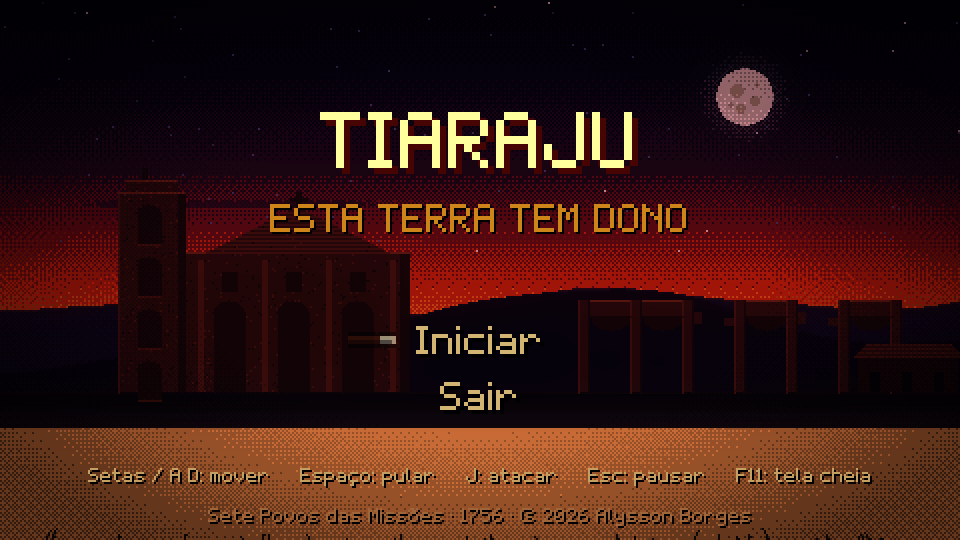
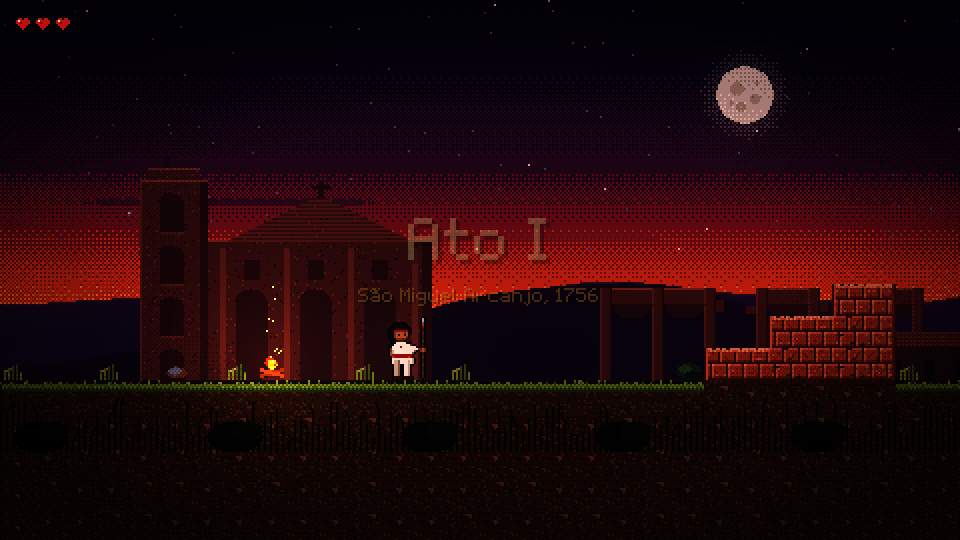
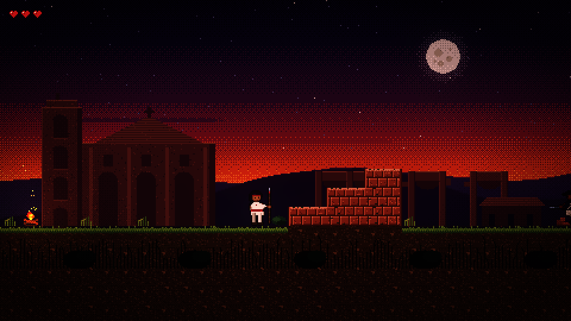

# Tiaraju — *Esta terra tem dono*

Jogo de ação e aventura 2D em **pixel art**, nativo para **macOS**, ambientado nos
**Sete Povos das Missões** em 1756. Você é **Sepé Tiaraju**, corregedor de São
Miguel Arcanjo, no ano em que os exércitos de Portugal e Espanha marcham para
expulsar os guaranis das reduções.





## O que já existe

- **Tela de título** com parallax das ruínas de São Miguel ao entardecer, lua, glow e trilha.
- **Introdução narrativa** (Tratado de Madri, os Sete Povos, a resposta de Sepé) com efeito
  de máquina de escrever sobre o *Lamento*.
- **Ato I — São Miguel Arcanjo**: fase de 240 tiles com chão de pampa, blocos de arenito,
  lajes de mão única, soldados luso-espanhóis que patrulham e dão botes de baioneta,
  cuias de chimarrão que curam, cruzes missioneiras como pontos de descanso e um arco
  de arenito como meta.
- **Game feel**: coyote time, jump buffer, pulo variável, squash & stretch, hit-stop,
  tremor de câmera, antecipação da câmera, poeira ao pular e aterrissar, flash ao acertar.
- **Luz e clima**: `CanvasModulate` de entardecer, `PointLight2D` nas fogueiras com tremulação,
  brasas, glow HDR 2D, vinheta pontilhada.
- **Trilha sonora dramática** sintetizada por script: *Esta terra tem dono* (tema, ~87 s,
  ré menor, 90 BPM) e *Lamento* (introdução), mais 13 efeitos e dois ambientes (vento, fogueira).
- **Fonte bitmap própria** ("Missões", 5x7 proporcional, com acentos do português e guarani).

## Controles

| Ação            | Teclado                | Controle |
|-----------------|------------------------|----------|
| Mover           | ← → ou A D             | analógico |
| Pular           | Espaço, W ou ↑         | A        |
| Atacar (lança)  | J, K ou X              | X        |
| Pausar          | Esc                    | Start    |
| Tela cheia      | F11                    |          |

## Como rodar

Requer **Godot 4.7.2** (`brew install --cask godot`).

```bash
godot --path .
```

Ou abra a pasta no editor do Godot e aperte F5. O jogo roda em 480x270 com escala
inteira (3x em 1440x810, 4x em 1080p).

### Exportar como app nativo de macOS

Instale os export templates da mesma versão (Editor → *Gerenciar Modelos de Exportação*
→ *Baixar e instalar*) e rode:

```bash
tools/export_mac.sh
```

Gera `export/Tiaraju.app` (universal, Apple Silicon + Intel, assinado ad-hoc).

## Pipeline de arte e som (sem dependências)

Todos os assets são gerados por scripts em Python puro (`python3` do sistema basta):

```bash
python3 tools/gen_assets.py      # sprites, tiles, fundos, fonte, UI, ícone (~5 s)
python3 tools/compose.py         # trilha, efeitos e ambientes (~1,5 min)
```

| Script                      | O que gera |
|-----------------------------|------------|
| `tools/pixelart.py`         | mini biblioteca: canvas RGBA, primitivas, dithering Bayer, contorno, PNG |
| `tools/palette.py`          | paleta do jogo (arenito, pampa, céu de entardecer) |
| `tools/gen_sprites.py`      | Sepé e o soldado: cabeça/torso em ASCII, pernas por rig de dois segmentos |
| `tools/gen_tiles.py`        | tileset (capim, terra, arenito, lajes, decoração), props, UI, luz, vinheta |
| `tools/gen_backgrounds.py`  | céu com lua, coxilhas, igreja de São Miguel com arcada e umbus, capim |
| `tools/gen_font.py`         | fonte BMFont `assets/fonts/missoes.fnt` + `.png` |
| `tools/compose.py`          | sintetizador: flauta (mimby), cordas, coro, baixo, metais, angu'a, takuapu, mbaraka, reverb |

Para mudar um sprite, edite o ASCII em `gen_sprites.py` e rode `gen_assets.py`.
Para mudar a fase, edite `scripts/levels/ato1_map.gd` (legenda no topo do arquivo).

## Estrutura

```
project.godot            480x270, escala inteira, HDR 2D, autoloads Game e Audio
scenes/                  título, intro, fase, jogador, inimigos, props, parallax, HUD
scripts/                 GDScript (jogador, soldado, câmera, montador de fase, áudio...)
scripts/levels/          mapas ASCII das fases
assets/                  tudo gerado: sprites, tiles, fundos, fonte, áudio, UI, shaders
tools/                   geradores de arte e som (Python puro) e export para macOS
docs/                    GDD e prints
```

## Contexto histórico

Em 1750 o **Tratado de Madri** entregou os Sete Povos (São Miguel, São Borja, São Nicolau,
São Luiz Gonzaga, São Lourenço Mártir, São João Batista e Santo Ângelo) a Portugal, exigindo
que cerca de trinta mil guaranis abandonassem suas reduções. A resistência virou a **Guerra
Guaranítica** (1754–1756). **Sepé Tiaraju** morreu em 7 de fevereiro de 1756, perto de São
Gabriel; três dias depois, na **Batalha de Caiboaté**, mais de mil e quinhentos guaranis foram
mortos. As ruínas de São Miguel Arcanjo são Patrimônio Mundial da UNESCO desde 1983.

## Roadmap

Ver [docs/gdd.md](docs/gdd.md). Próximos passos: Ato II (o pampa e Caiboaté), Ato III
(*Yvy Marã Ey*, a Terra sem Mal), chefes, cavalo crioulo, mais inimigos, trilha por ato.

---
© 2026 Alysson Borges. Feito com Godot 4.7.
